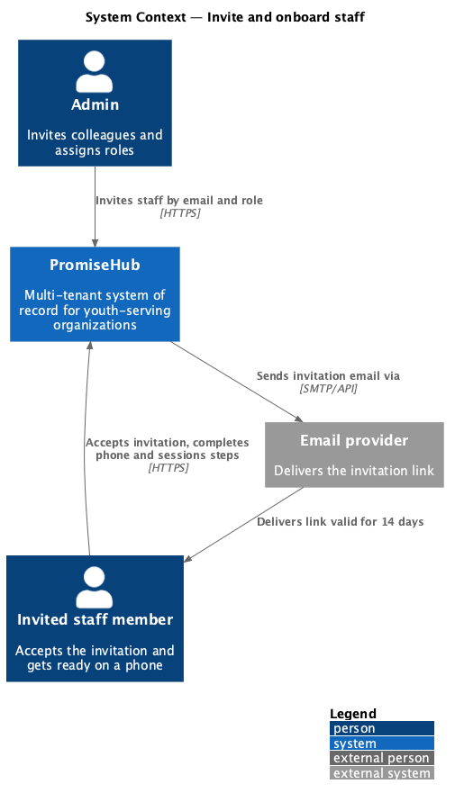
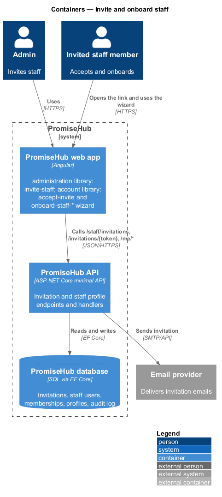
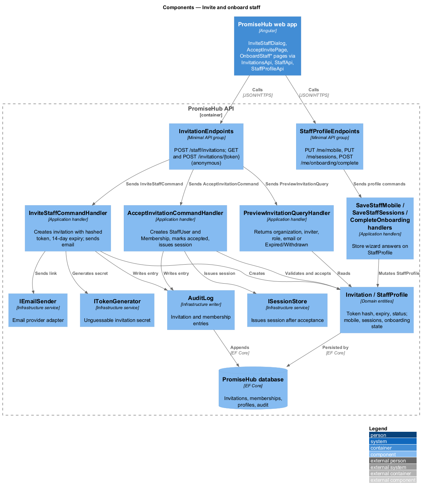
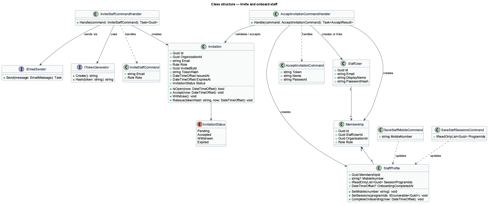
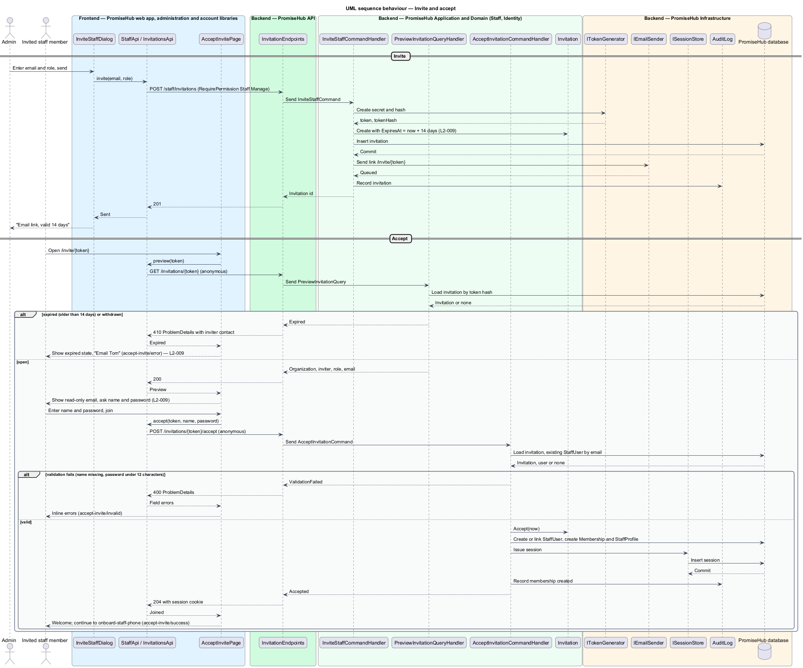
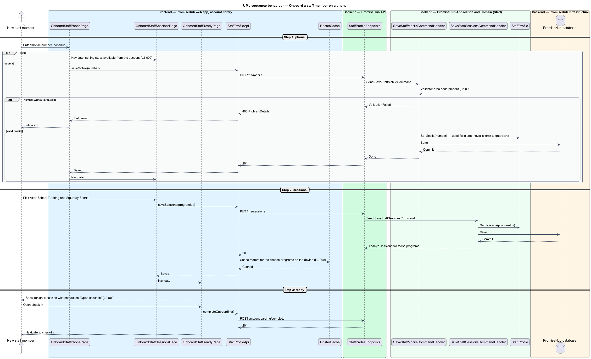

# Invite and onboard staff

## Overview

PromiseHub is a phone-first system of record for small youth-serving non-profits. Staff join an organization by invitation, never by open registration. This feature covers the path from an admin sending an invitation (`invite-staff`) to a newly invited staff member running tonight's check-in: accepting the invitation (`accept-invite`), then three short steps that collect a mobile number (`onboard-staff-phone`), the sessions the person runs (`onboard-staff-sessions`) and a ready screen with one action to open check-in (`onboard-staff-ready`).

An admin enters an email and a role; PromiseHub emails a link that stays valid for 14 days. The invited person opens the link, sees the invited email read-only, enters a name and a password and joins the organization. A link older than 14 days, or one the admin has withdrawn, shows the expired state with a way to contact the inviter. Each onboarding step may be skipped; a skipped setting remains available from the person's account. The mobile number collected in the phone step is used for staff alerts and never shown to guardians. Choosing sessions caches those rosters on the device so check-in works without signal.

Terms used in this document:

- **invitation** — record that offers one email address a membership in one organization with one role, carrying a single-use token that expires 14 days after issue
- **invitation token** — unguessable secret in the invitation link whose hash is stored on the invitation
- **staff onboarding** — three-step wizard shown once after accepting an invitation
- **session preference** — set of programs a staff member runs, used to pick rosters to cache and to compose Today

## Description

The feature spans the administration and account libraries on the frontend and the `Staff` and `Identity` folders in the application layer.

Frontend:

- **`InviteStaffDialog`** — CDK dialog in `frontend/projects/administration/` for `invite-staff`. It collects email and role and calls `StaffApi.invite`. The `staff` page lists pending invitations with withdraw and resend actions.
- **`AcceptInvitePage`** — page in `frontend/projects/account/` for route `/invite/:token`, rendered in the authentication card. States: `default`, `invalid`, `submitting`, `success` and `error` (expired or withdrawn, with an email link to the inviter).
- **`OnboardStaffPhonePage`**, **`OnboardStaffSessionsPage`**, **`OnboardStaffReadyPage`** — wizard pages in `frontend/projects/account/` for `/welcome/phone`, `/welcome/sessions` and `/welcome/ready`, rendered in the design system's `wizard-layout` with one question per screen and a skip link on each.
- **`InvitationsApi`** — typed client in `frontend/projects/api/` behind `INVITATIONS_API` with `preview(token)`, `accept(token, name, password)`.
- **`StaffApi`** — typed client behind `STAFF_API` with `invite`, `withdrawInvitation`, `resendInvitation`.
- **`StaffProfileApi`** — typed client behind `STAFF_PROFILE_API` with `saveMobile`, `saveSessions`, `completeOnboarding`.
- **`RosterCache`** — service in `frontend/projects/api/` that stores today's rosters for the chosen programs in IndexedDB; it belongs to the offline design and is called here after the sessions step.

Backend:

- **`InvitationEndpoints`** — minimal-API group in `PromiseHub.Api`: `POST /staff/invitations` (requires `Staff.Manage`), `DELETE /staff/invitations/{id}`, `POST /staff/invitations/{id}/resend`, and anonymous `GET /invitations/{token}` and `POST /invitations/{token}/accept`.
- **`StaffProfileEndpoints`** — `PUT /me/mobile`, `PUT /me/sessions`, `POST /me/onboarding/complete`.
- **`InviteStaffCommand` / `InviteStaffCommandHandler`** — validates the email, creates an `Invitation` with a hashed token and a 14-day expiry, sends the email through `IEmailSender`, writes an audit entry.
- **`PreviewInvitationQuery` / `PreviewInvitationQueryHandler`** — returns the organization name, inviter name, role and email for a valid token; returns `Expired` or `Withdrawn` otherwise.
- **`AcceptInvitationCommand` / `AcceptInvitationCommandHandler`** — checks the token and expiry, creates or links the `StaffUser`, creates the `Membership` with the invited role, marks the invitation accepted and issues a session through `ISessionStore` so the person lands in the wizard signed in.
- **`SaveStaffMobileCommand`**, **`SaveStaffSessionsCommand`**, **`CompleteOnboardingCommand`** and their handlers in `PromiseHub.Application/Staff/`. The mobile validator rejects a number without an area code.
- **`Invitation`**, **`StaffProfile`** — domain entities. `StaffProfile` holds `MobileNumber`, `SessionProgramIds` and `OnboardingCompletedAt` per membership. `MobileNumber` is never included in any guardian-facing DTO.
- **`IEmailSender`**, **`ITokenGenerator`**, **`AuditLog`** — infrastructure services. `ITokenGenerator` produces the invitation secret; its length is `<TO SUPPLY>`.

## Requirements

The feature realizes the following level-2 (L2) requirements. Each L2 requirement refines a level-1 (L1) requirement, cited by identifier.

| L2 ID | Refines (L1) | Requirement |
|-------|--------------|-------------|
| `L2-009` | `L1-004` | An invited staff member accepts the invitation, then completes three steps: phone, sessions, ready (`accept-invite`, `onboard-staff-phone`, `onboard-staff-sessions`, `onboard-staff-ready`). |
| `L2-007` | `L1-003` | Permissions are enforced per endpoint and per field by role; the UI reflects them but never substitutes for them. |

## Diagrams

### System context

An admin invites a colleague; PromiseHub emails the link through the email provider; the invited person accepts and gets ready on a phone.

### Containers

The administration and account libraries of the PromiseHub web app call the PromiseHub API, which stores invitations, memberships and profiles and sends the invitation email.

### Components

`InvitationEndpoints` dispatches invite, preview and accept commands; `StaffProfileEndpoints` dispatches the wizard commands. Handlers use the email sender, token generator, session store and audit log.

### Class structure

`Invitation` carries the hashed token and expiry; accepting it yields a `Membership` and a `StaffProfile` that the wizard fills in.

### Behaviour — invite and accept

The admin's invitation is emailed with a 14-day token; the invited person's acceptance creates the membership and signs them in, or shows the expired state (`L2-009`).

### Behaviour — onboard on a phone

Each wizard step saves one setting and may be skipped; the sessions step caches the chosen rosters; the ready screen opens tonight's check-in (`L2-009`).

