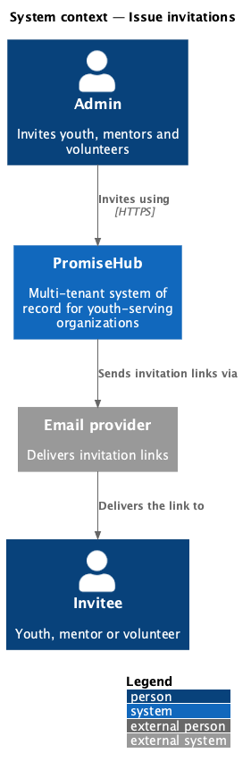
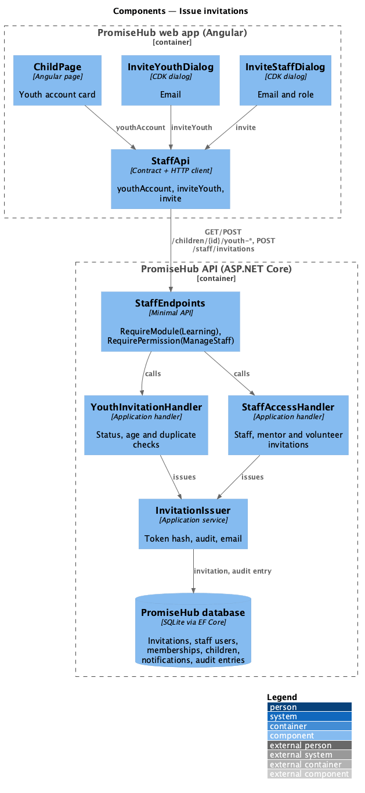
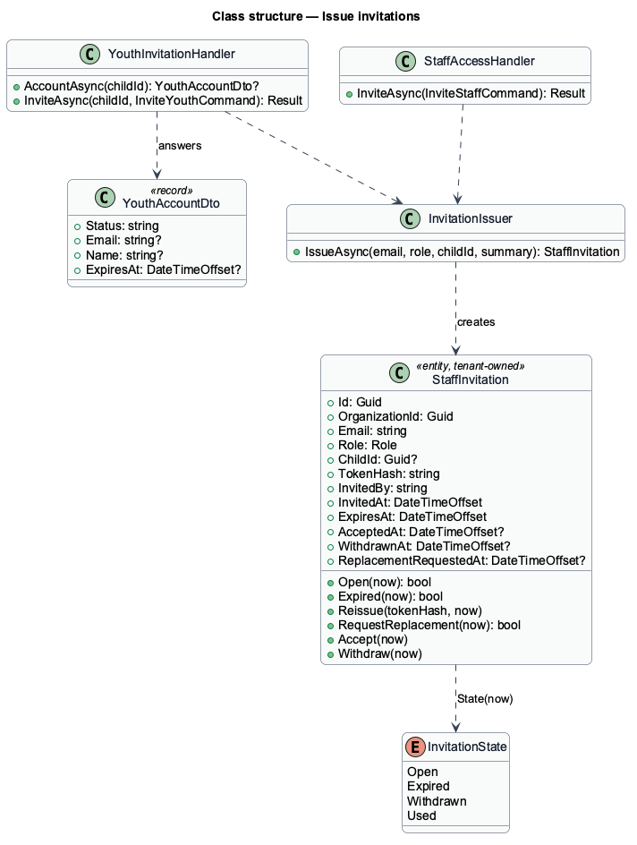
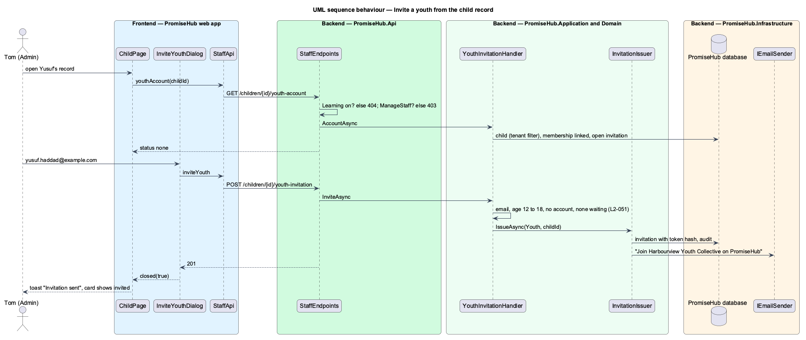

# Issue invitations

## Overview

PromiseHub accounts are created only by invitation. Prompts 29 and 30 built staff invitations: an admin enters a work email and a role on Staff and roles (`invite-staff`), PromiseHub emails a single-use link that lasts 14 days, and the invited person accepts it (`accept-invite`). ADR 0043 added three roles that also need accounts: **Youth**, **Mentor** and **Volunteer**. This feature extends the same invitation so an admin can invite them; it does not add a second invitation system (ADR 0045).

A youth is invited from their own child record, because a youth account always links to one child (`L2-045`). Tom (Admin) opens Yusuf Haddad's record, sees the **Youth account** card and sends an invitation to Yusuf's own email (`child/youth-account`, `invite-youth`). Mentors and volunteers are invited from Staff and roles like any staff role. The Youth account card and its endpoints exist only while the Learning module is on, and the Mentor role is offered only while Mentoring is on.

Terms used in this document:

- **invitation** — a `StaffInvitation` row: one email, one organization, one role, a hashed single-use token and a 14-day expiry
- **youth invitation** — an invitation with the Youth role and a `ChildId`, the record the new account links to
- **youth account status** — what the Youth account card shows for a child: none, invited (email and expiry) or active (name and email)

Ported from Waypoint `authentication/issue-invitations` (`L2-AUTH-003`). Waypoint's bulk invite, cohort and mentor scope are deferred: PromiseHub has no cohorts until prompt 54.

## Description

Frontend:

- **`ChildPage`** (`frontend/projects/households/`) — renders the Youth account card when the session's role holds `manageStaff`, Learning is in `Session.modules` and the child is 12 to 18. It reads `StaffApi.youthAccount(childId)` and shows an empty state with **Invite to PromiseHub**, the waiting invitation, or the active account.
- **`InviteYouthDialog`** (`frontend/projects/households/`) — CDK dialog with one email field; calls `StaffApi.inviteYouth(childId, email)` and closes with `true`, after which the page shows the toast "Invitation sent".
- **`InviteStaffDialog`** (`frontend/projects/administration/`) — its role options add Volunteer always and Mentor while Mentoring is on.
- **`StaffApi`** (`frontend/projects/api/`) — gains `youthAccount(childId)` and `inviteYouth(childId, email)`; the `YouthAccount` contract is one file.

Backend:

- **`YouthInvitationHandler`** (`PromiseHub.Application/Staff/`) — `AccountAsync(childId)` answers the youth account status; `InviteAsync(childId, command)` validates the email, the age (12 to 18), that the child has no youth account and no invitation waiting, and that the email has no access yet, then issues the invitation through `InvitationIssuer`.
- **`InvitationIssuer`** (`PromiseHub.Application/Staff/`) — creates the token with `GuardianTokens`, stores only its hash, audits "invited as {role}" (with the child for a youth), saves and emails "Join {organization} on PromiseHub" with the `/invite/{token}` link. `StaffAccessHandler.InviteAsync` and `ResendAsync` use it too.
- **`StaffAccessHandler.InviteAsync`** — accepts Mentor (only while Mentoring is on, read through `IModuleGate`) and Volunteer; refuses Youth with "Invite youth from their child record.".
- **`StaffEndpoints`** — `GET /children/{id}/youth-account` and `POST /children/{id}/youth-invitation`, each `RequireModule(Learning)` and `RequirePermission(ManageStaff)`. The tenant filter makes another organization's child not found.
- **`StaffInvitation`** — gains `ChildId` (migration `InvitationReplacement`).

## Requirements

| L2 ID | Refines (L1) | Requirement |
|-------|--------------|-------------|
| `L2-051` | `L1-003` | An admin invites a youth from their child record and a mentor or volunteer from Staff and roles. Every invitation is the same emailed, single-use link that lasts 14 days; a youth invitation also names the child record the new account will link to. |
| `L2-045` | `L1-003` | A youth signs in with a membership whose role is Youth, and that membership links to exactly one child record in the same organization. |
| `L2-009` | `L1-004` | An invited staff member accepts the invitation, then completes three steps: phone, sessions, ready. |
| `L2-007` | `L1-003` | Permissions are enforced per endpoint by role on the server. |

## Diagrams

### System context

An admin invites a youth, mentor or volunteer; PromiseHub emails the link through the email provider.

### Components

`ChildPage` and `InviteYouthDialog` call `StaffApi`; the youth-account endpoints are gated by the Learning module and the `ManageStaff` permission and delegate to `YouthInvitationHandler`, which issues through `InvitationIssuer`.

### Class structure

A youth invitation is a `StaffInvitation` with the Youth role and a `ChildId`; both issuers share `InvitationIssuer`.

### Behaviour — invite a youth from the child record

The server checks the module, the permission, the age and that no account or invitation exists, then stores the hash, audits and emails the link (`L2-051`).

