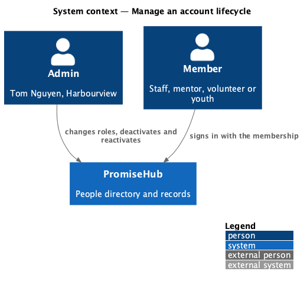
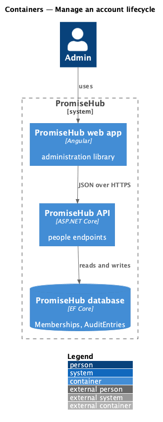
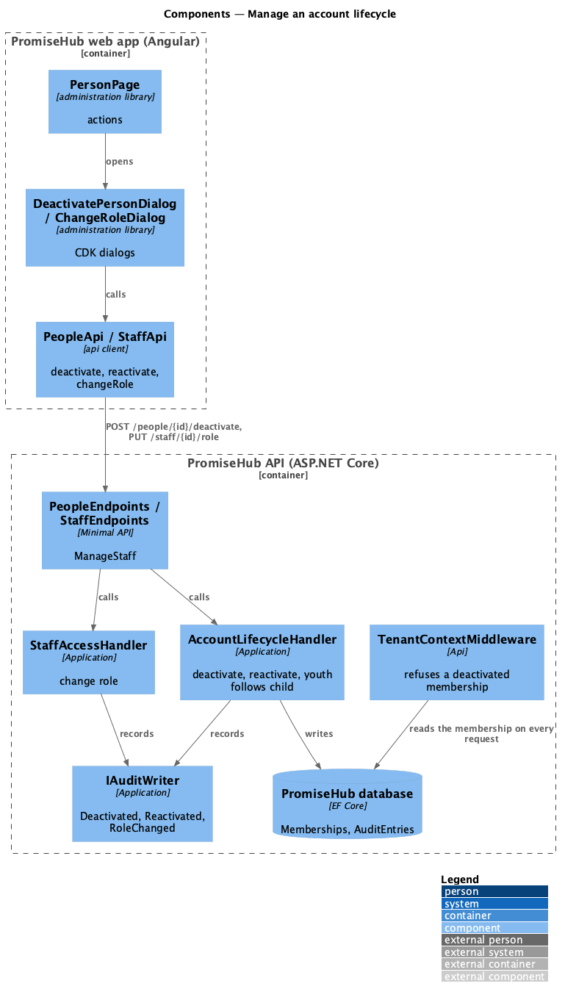
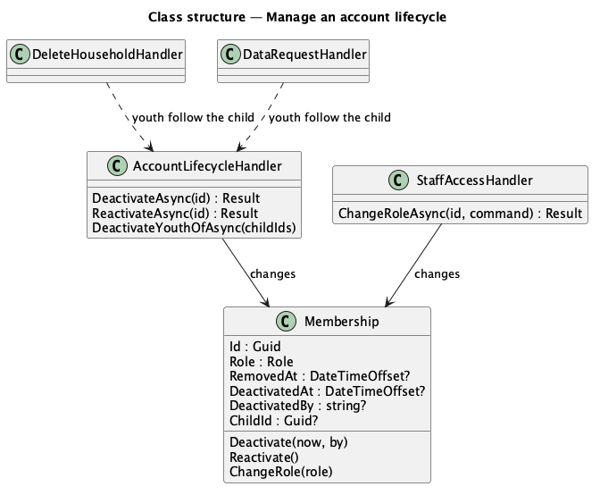
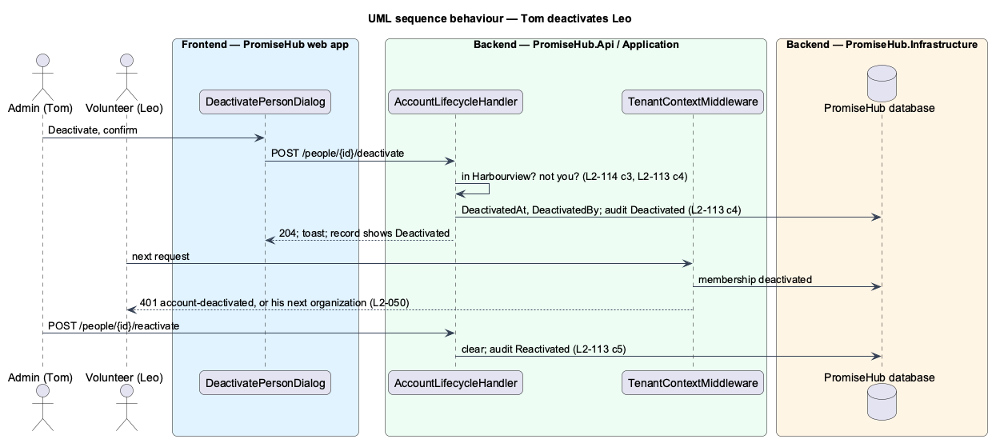
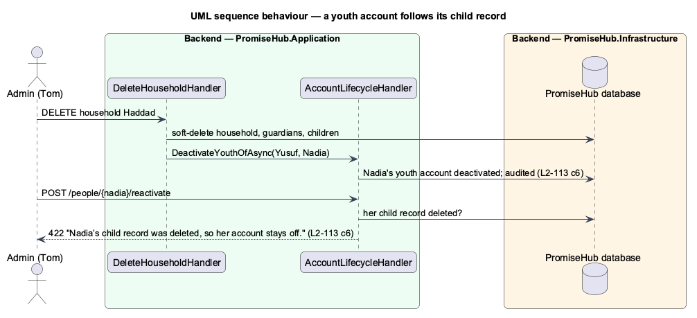

# Manage an account lifecycle

## Overview

People join, change jobs and leave. **Manage an account lifecycle** lets an admin change a person's role, turn their account off when they leave (deactivate) and back on when they return (reactivate), from the person record. Nothing is deleted: a deactivated person keeps their records and history and simply cannot sign in to that organization. A youth account follows its child record: when the household is deleted the account is deactivated with it and cannot come back. Every change is audited.

Terms used in this document:

- **deactivated** — `Membership.DeactivatedAt` is set; the membership cannot start or continue a session (ADR 0070)
- **staff role** — Admin, Program director, Site lead, Youth worker or Volunteer coordinator; **participant role** — Mentor, Volunteer or Youth (ADR 0043)

Ported from Waypoint `program-administration/manage-account-lifecycle` (`L2-ADMIN-002`, `L2-AUTH-009`, ADR 0043, ADR 0070). Removal stays on Staff and roles; password reset from the record is deferred to prompt 77.

## Description

### Backend

- **`Membership`** (`PromiseHub.Domain/Organizations/`) — `DeactivatedAt`, `DeactivatedBy`, `Deactivate(now, by)`, `Reactivate()` and `IsActive` (not removed and not deactivated).
- **`AccountLifecycleHandler`** (`PromiseHub.Application/Staff/`) — `DeactivateAsync` (404 outside the organization or removed; 422 for your own; idempotent; audited `Deactivated`), `ReactivateAsync` (422 when a youth's child record is deleted; idempotent; audited `Reactivated`) and `DeactivateYouthOfAsync(childIds)` used by `DeleteHouseholdHandler` and `DataRequestHandler`.
- **`StaffAccessHandler.ChangeRoleAsync`** — refuses a youth account, a change to Youth and Mentor while Mentoring is off with 422; audited `RoleChanged` with before and after.
- **Sessions** — `ActiveMembership`, `SignInHandler`, `SwitchOrganizationHandler` and `TenantContextMiddleware` treat a deactivated membership like a removed one, so the next request continues in another organization or answers 401 `account-deactivated`.
- **`PeopleEndpoints`** — `POST /people/{id}/deactivate` and `POST /people/{id}/reactivate` with `ManageStaff`.

### Frontend

- **`PeopleApi.deactivate(id)`, `reactivate(id)`**; role changes keep `STAFF_API.changeRole`.
- **`DeactivatePersonDialog`** (mock `deactivate-person`) — CDK dialog with Cancel focused and a danger Deactivate that is busy while saving; a failed alert keeps it open.
- **`ChangeRoleDialog`** (mock `change-role`) — the staff roles, Volunteer and Mentor while Mentoring is on; a warning alert when a participant moves to a staff role.
- **`PersonPage`** — Change role (not on a youth account or your own), Deactivate, Reactivate (disabled when the child record is deleted), toasts after each.

Open questions: none.

## Requirements

| L2 ID | Refines (L1) | Requirement |
|-------|--------------|-------------|
| `L2-113` | `L1-003` | Each account shall have a record from which an admin changes the role and deactivates or reactivates it; a youth account follows its child record; nothing is deleted and every change is audited. |
| `L2-114` | `L1-016` | Only an admin of the organization shall read or change its people, whatever the client shows. |
| `L2-050` | `L1-003` | Session-expired and account-inactive states (cross-referenced). |
| `L2-032` | `L1-017` | Audit trail (cross-referenced). |

## Diagrams

### System context

Tom changes roles and turns accounts off and on; the member's next request follows.

### Containers

The record's dialogs call the API, which changes the membership the session reads.

### Components

The lifecycle handler and the tenant middleware share the membership's state.

### Class structure

Deactivation is state on the membership.

### Behaviour — Tom deactivates Leo

Leo's next request answers that the account is inactive.

### Behaviour — the Haddad household is deleted

Nadia's youth account is deactivated with her child record and stays off.

