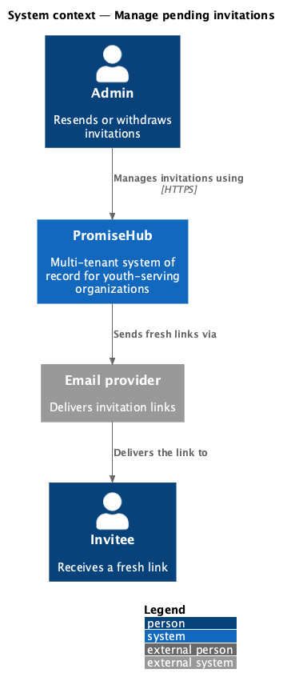
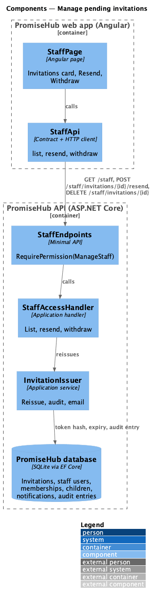
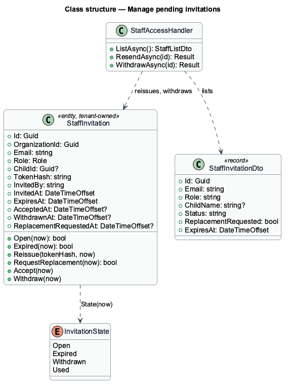
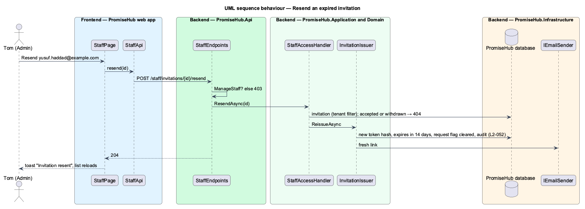

# Manage pending invitations

## Overview

An invitation can sit unanswered: the email went to spam, or the link timed out after 14 days. Staff and roles (`staff`) already listed waiting invitations with Withdraw (prompt 29). This feature lists expired invitations too, adds **Resend**, which issues a fresh link on the same invitation, and marks an invitation whose invitee asked for a new link (`replace-expired-invitation`).

Resending replaces the token hash and moves the expiry to 14 days from now, so the previous link stops working at once; the request flag clears. Withdrawing (Waypoint's "revoke") stays as built and is audited. Accepted and withdrawn invitations leave the list.

Terms used in this document:

- **waiting invitation** — not accepted, not withdrawn and not expired
- **expired invitation** — not accepted and not withdrawn, past its expiry; still listed so it can be resent
- **resend** — reissue: a new token and a new 14-day expiry on the same row, emailed again

Ported from Waypoint `authentication/manage-pending-invitations` (`L2-AUTH-004`). Waypoint's accepted-history tab and export are deferred.

## Description

Frontend:

- **`StaffPage`** (`frontend/projects/administration/`) — the invitations card lists each invitation's email, role, child, inviter and expiry, a badge "Expired" and "Asked for a new link" where they apply, and **Resend** and **Withdraw** buttons with accessible names that include the email. Resend shows the toast "Invitation resent".
- **`StaffApi.resend(id)`** and **`StaffApi.withdraw(id)`** (`frontend/projects/api/`). `StaffList.invitations` gains `status`, `childName` and `replacementRequested`.

Backend:

- **`StaffAccessHandler.ListAsync`** — invitations not accepted and not withdrawn, with `Status` "Pending" or "Expired", the child's name for a youth invitation and `ReplacementRequested`.
- **`StaffAccessHandler.ResendAsync(id)`** — 404 for an unknown, accepted or withdrawn invitation; otherwise `InvitationIssuer.ReissueAsync`, which calls `StaffInvitation.Reissue`, audits "Invitation to {email} resent by {actor}" and emails the new link.
- **`StaffEndpoints`** — `POST /staff/invitations/{id}/resend` with `RequirePermission(ManageStaff)`; `DELETE /staff/invitations/{id}` unchanged.

## Built so far

Prompt 51 delivered everything above: the invitations card with Expired, Asked for a new link, Resend and Withdraw, `StaffAccessHandler.ResendAsync` and `POST /staff/invitations/{id}/resend`. Acceptance tests: `backend/tests/PromiseHub.Api.Tests/PendingInvitationTests.cs`, `e2e/tests/administration/pending-invitations.spec.ts`.

## Requirements

| L2 ID | Refines (L1) | Requirement |
|-------|--------------|-------------|
| `L2-052` | `L1-003` | The invitee sets a name and a password and is signed in with the role the invitation carries. Admins resend a fresh link or withdraw one, and a link that was used, withdrawn or replaced never works again. |
| `L2-054` | `L1-003` | An invitation link that timed out shows its own state and lets the invitee ask, without an account, for a fresh link; the admins see the request and resend. |

## Diagrams

### System context

The admin resends or withdraws; the invitee receives the fresh link by email.

### Components

`StaffPage` calls `StaffApi`; `StaffEndpoints` hands resend to `StaffAccessHandler`, which reissues through `InvitationIssuer`.

### Class structure

`Reissue` replaces the token hash and the expiry and clears the request flag.

### Behaviour — resend an expired invitation

The old hash is overwritten, so the old link answers 410 and only the new one works (`L2-052`).

