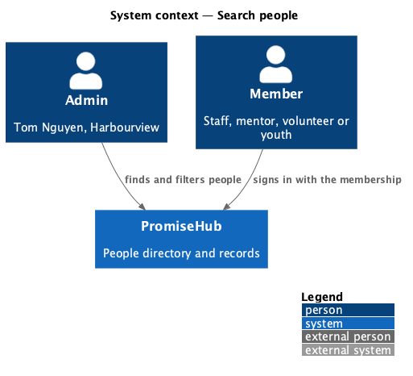
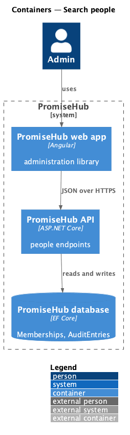
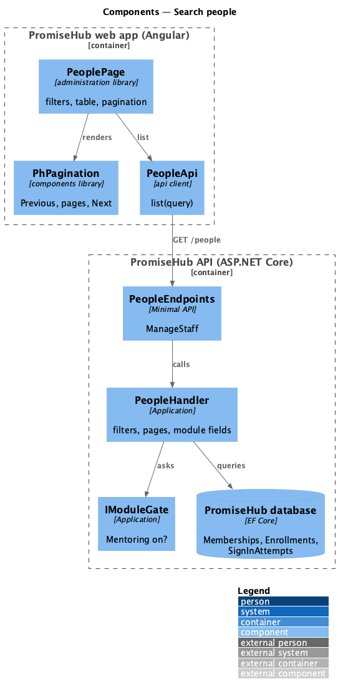
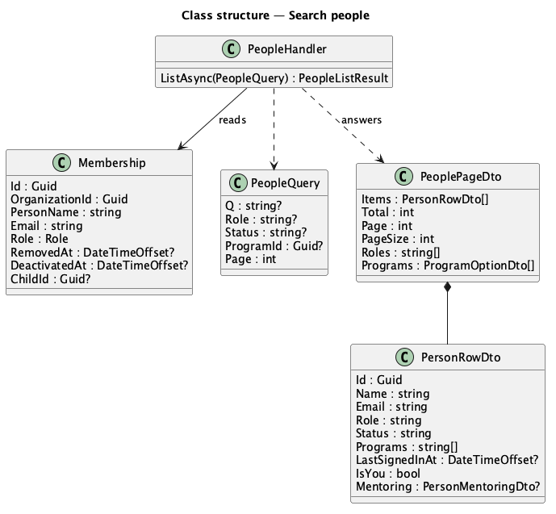
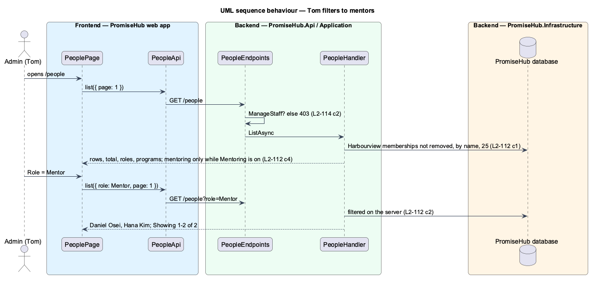

# Search people

## Overview

An admin needs one place to find anyone with an account in the organization: staff, mentors, volunteers and youth. **Search people** is the People directory at `/people`: one table of the organization's accounts with a search box and role, status and program filters, a page of 25 at a time, each name opening the person's record. It is admins only and always on; it extends Staff and roles (`invite-and-onboard-staff`), which keeps invitations and removal.

Terms used in this document:

- **person** — one `Membership` of the active organization that is not removed (ADR 0070); a person in two organizations is a row in each
- **status** — Active, or Deactivated while `Membership.DeactivatedAt` is set
- **programs** — a youth's child's current enrollments, or a mentor's cohorts (`CohortMentor`) while Mentoring is on

Ported from Waypoint `program-administration/search-people` (`L2-ADMIN-001`, ADR 0043, ADR 0070).

## Description

### Backend

- **`PeopleHandler.ListAsync`** (`PromiseHub.Application/Staff/`) — filters memberships by `q` (name or email, ignoring case), `role`, `status` and `programId`, orders by name, counts, skips to the page and answers `PeoplePageDto` with `PersonRowDto` rows (id, name, email, role, status, programs, last signed in from the newest successful `SignInAttempt` for the email, `isYou`, and `mentoring` only while Mentoring is on), the roles a filter may name (no Mentor while Mentoring is off) and the active programs. An unknown role or status, or Mentor while Mentoring is off, answers 422.
- **`PeopleEndpoints`** (`PromiseHub.Api/Endpoints/`) — `GET /people` with `RequirePermission(Permission.ManageStaff)`; the tenant comes from the session and the query filter on `Memberships` keeps every other organization out.

### Frontend

- **`PeopleApi`**, `PEOPLE_API` and `HttpPeopleApi` (`frontend/projects/api/src/lib/people/`) with `PeopleQuery`, `PeoplePage` and `PersonRow`.
- **`PeoplePage`** (`frontend/projects/administration/`, mock `people`) — page header with Invite staff, a toolbar of `ph-text-field` (search) and `ph-select` for role, status and program, `ph-table` with a link per person, `ph-pagination`, the no-results, empty, error and forbidden states and a skeleton while loading.
- **`PhPagination`** (`frontend/projects/components/`) — Previous, numbered pages and Next with `aria-current`, and the Showing n–m of total status; it replaces the audit log's own pager.
- **Navigation** — People in the More menu for admins (`navigation.ts`), route `/people` in the app.

Open questions: none.

## Requirements

| L2 ID | Refines (L1) | Requirement |
|-------|--------------|-------------|
| `L2-112` | `L1-003` | Admins shall list, search and filter every account of their organization (staff, mentors, volunteers and youth) in one directory, a page at a time. |
| `L2-114` | `L1-016` | Only an admin of the organization shall read or change its people, whatever the client shows. |
| `L2-007` | `L1-003` | Role-based authorization on the server (cross-referenced). |
| `L2-001` | `L1-001` | Tenant isolation (cross-referenced). |

## Diagrams

### System context

Tom finds people in PromiseHub.

### Containers

The administration library reads the directory from the API.

### Components

The page asks the people API; the handler filters memberships on the server and leaves module fields out while their module is off.

### Class structure

A row is projected from a membership.

### Behaviour — Tom filters to mentors

The filter runs on the server and the first page comes back.

