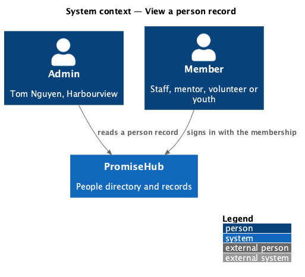
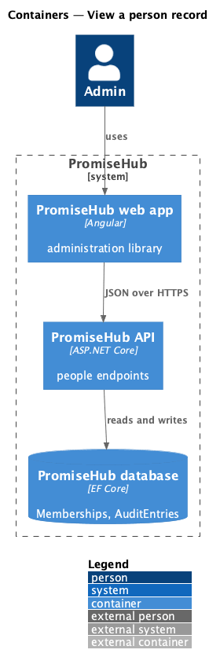
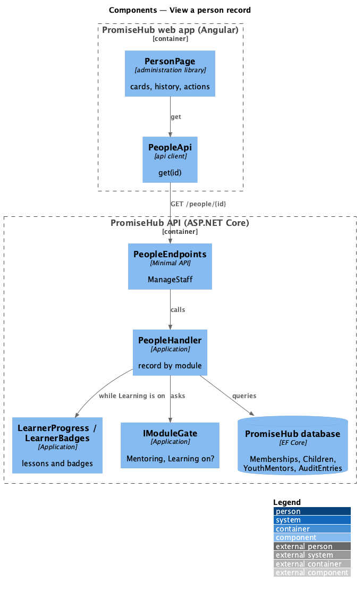
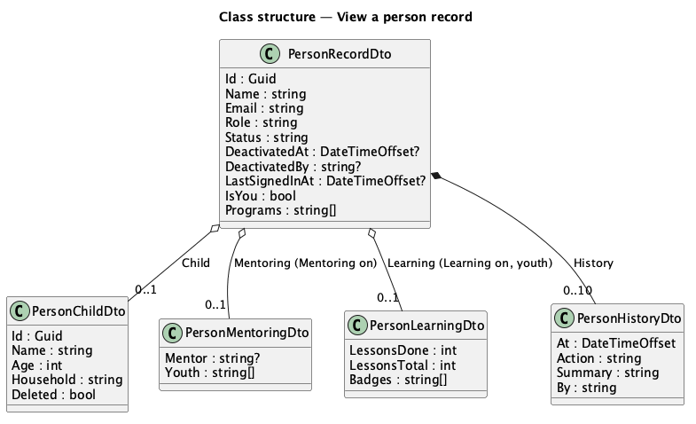
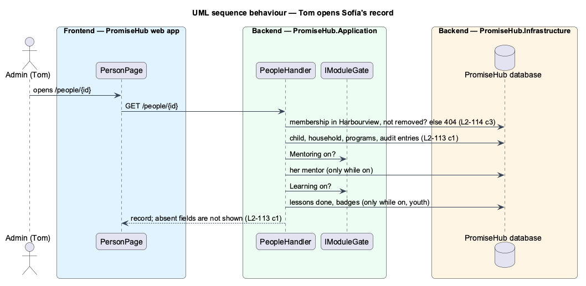

# View a person record

## Overview

From the directory an admin opens one person to see who they are in the organization and what their account has been through. **View a person record** is the page at `/people/{id}`: the account (email, role, status, last sign-in), for a youth the child record her account follows with her programs, her mentor while Mentoring is on and her Learning progress while Learning is on, for a mentor the youth assigned to him, and the account's history from the audit log. The record carries the lifecycle actions (`manage-account-lifecycle`).

Terms used in this document:

- **record** — `PersonRecordDto`, what `GET /people/{id}` answers for one membership of the active organization
- **history** — the ten newest `AuditEntry` rows whose record is the membership, newest first

Ported from Waypoint `program-administration/view-person-record` (`L2-ADMIN-002`, ADR 0043, ADR 0070). Profile editing, staff notes and the youth's consent and attendance tabs are deferred (ADR 0070).

## Description

### Backend

- **`PeopleHandler.GetAsync`** (`PromiseHub.Application/Staff/`) — finds the membership (not removed) in the active organization or answers 404; answers name, email, role, status, `deactivatedAt` and `deactivatedBy`, last sign-in, `isYou`, the linked child (`PersonChildDto`: id, name, age, household and whether it was deleted), programs, the history and, by module, `mentoring` (`PersonMentoringDto`: a youth's mentor from `YouthMentor`, a mentor's youth) and `learning` (`PersonLearningDto`: lessons done of total and badges, through `LearnerProgress` and `LearnerBadges` for the youth's membership). A field of a module that is off is omitted from the JSON.
- **`PeopleEndpoints`** — `GET /people/{id:guid}` with `ManageStaff`.

### Frontend

- **`PeopleApi.get(id)`** with `PersonRecord`.
- **`PersonPage`** (`frontend/projects/administration/`, mock `person`) — breadcrumb to People, page header with role and status badges and the actions, cards with `ph-description-list` (Account, Youth record, Mentoring, Learning with `ph-progress-bar`), History as `ph-list`, the info alerts for your own record and a deleted child record, and the loading, error and forbidden states.

Open questions: none.

## Requirements

| L2 ID | Refines (L1) | Requirement |
|-------|--------------|-------------|
| `L2-113` | `L1-003` | Each account shall have a record from which an admin changes the role and deactivates or reactivates it; a youth account follows its child record; nothing is deleted and every change is audited. |
| `L2-114` | `L1-016` | Only an admin of the organization shall read or change its people, whatever the client shows. |
| `L2-045` | `L1-003` | Youth accounts linked to a child record (cross-referenced). |
| `L2-032` | `L1-017` | Audit trail (cross-referenced). |

## Diagrams

### System context

Tom reads a person's record in PromiseHub.

### Containers

The administration library reads the record from the API.

### Components

The handler joins the membership with its child, programs, mentor, Learning progress and audit entries.

### Class structure

The record and its optional, module-gated parts.

### Behaviour — Tom opens Sofía's record

Each module-gated part is read only while its module is on.

