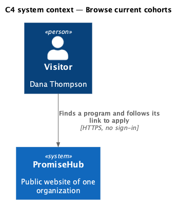
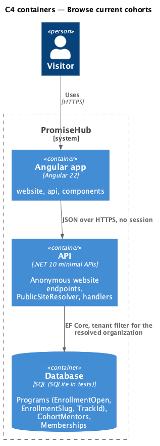
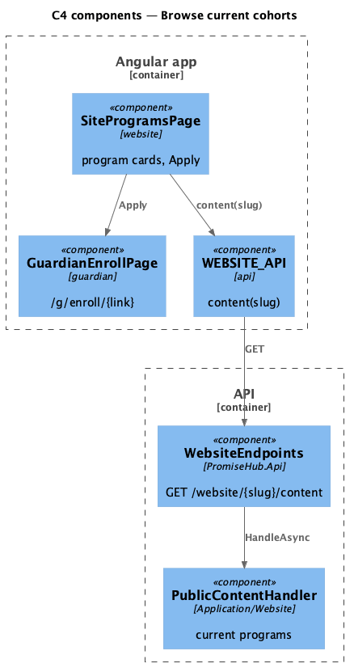
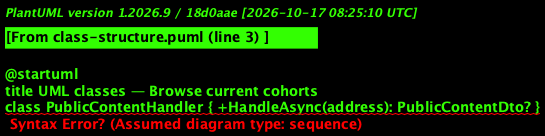
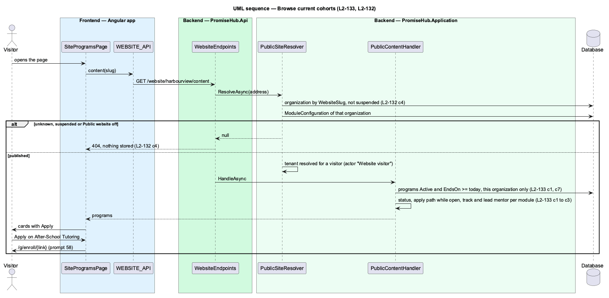

# Browse current cohorts

## Overview

A Waypoint cohort is a PromiseHub program (ADR 0043). The programs section of the Programs page and the Open now section of the home page list the organization's current programs: active, not archived and not yet ended. Each says when it meets, who it is for, when it runs and whether it is running or starting soon, and offers Apply while enrollment is open. Apply is the program's enrollment link from prompt 58 (`/g/enroll/{link}`), so applying is the same flow a family already uses.

Terms used in this document:

- **status** — `Running` once the start date has passed, `Upcoming` before; computed once on the server from the organization's today, so every page shows the same status
- **apply path** — `/g/enroll/{EnrollmentSlug}`, answered only while `EnrollmentOpen`
- **lead mentor** — the first name of the program's `CohortMentor` marked lead, answered only while Mentoring is on

Ported from Waypoint's `public-site/browse-current-cohorts` design (`L2-PUB-002` criteria 2 and 4), with tenancy and the Public website module gate added (ADR 0043, ADR 0075).

## Description

Frontend:

- **`SiteProgramsPage`** and **`SiteLandingPage`** — a `ph-card` per program with `ph-badge` (Running now, or Starts {date}), `ph-description-list` (When, Who, Runs, Learning track, Lead mentor) and an Apply `ph-button` link whose accessible name includes the program; a closed program says "Enrollment is closed for now" instead; the empty state offers Contact us.
- **`PublicProgram`** (`frontend/projects/api/`) — the contract.

Backend:

- **`PublicContentHandler`** — programs where `Status == Active` and `EndsOn >= today`, ordered by start date and name; status from the start date; the apply path only while enrollment is open; the track name while Learning is on and the track is published; the lead mentor's first name while Mentoring is on.
- **`PublicProgramDto`** — `Name, Schedule?, Ages?, StartsOn, EndsOn, Status, ApplyPath?, Track?, LeadMentor?`; no capacity, counts or children.

## Built so far

Prompt 81 delivered everything above. Acceptance tests: `backend/tests/PromiseHub.Api.Tests/PublicContentTests.cs`, `e2e/tests/website/programs.spec.ts`.

## Requirements

| L2 ID | Refines (L1) | Requirement |
|-------|--------------|-------------|
| `L2-133` | `L1-025` | The public pages show only what an organization has published: current programs with a link to apply, published tracks and modules while Learning is on, and the mentorship model and lead mentors while Mentoring is on. |
| `L2-132` | `L1-025` | While Public website is on, a visitor reads an organization's public pages at `/site/{address}` without an account; an unknown address, a suspended organization and the module off all answer the same not-found page and 404. |
| `L2-001` | `L1-001` | Every query filters by the organization; another organization's data is never returned. |

## Diagrams

A visitor finds a program and applies through its enrollment link.

The Angular app calls the API anonymously; the API resolves the organization from the address and reads its module configuration on every request.

The page links to the guardian enrollment page; it never posts an application itself.

A program's public view leaves out capacity, enrollment counts and every person except the lead mentor's first name.

The tenant filter of the resolved organization keeps another organization's programs out.

