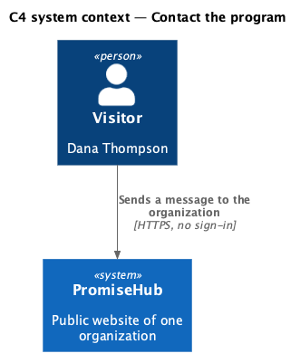
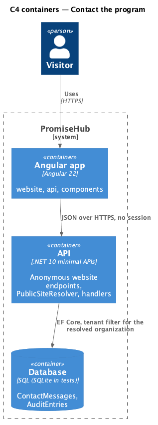
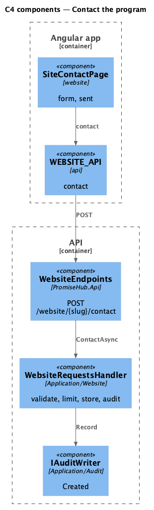
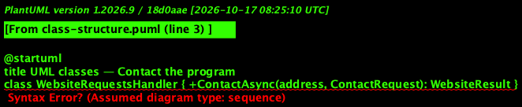
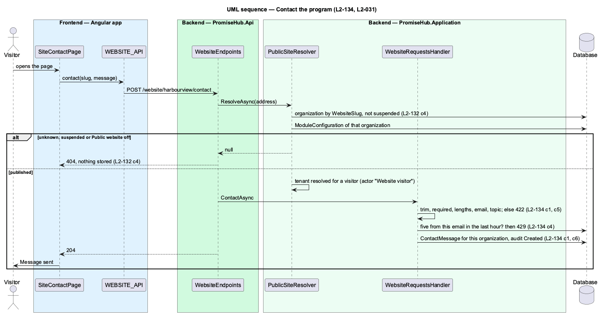

# Contact the program

## Overview

The contact page (`site-contact`) lets anyone write to the organization: a name, an email, a topic and a message. The page is the form itself, a dedicated screen rather than inline editing. The message is checked on the server, stored for that organization, audited and acknowledged; a sixth message from one email within an hour is refused. Reading these messages inside PromiseHub is deferred (ADR 0075); until then they sit in the database and the audit log.

Terms used in this document:

- **topic** — Programs and enrollment, Volunteering, Giving or Something else
- **limit** — five requests of one kind from one email to one organization within an hour; the sixth answers 429 `too-many`

Ported from Waypoint's `public-site/contact-program` design (`L2-PUB-003` criteria 1 and 4), with tenancy and the Public website module gate added (ADR 0043, ADR 0075).

## Description

Frontend:

- **`SiteContactPage`** — `ph-text-field` (name, email), `ph-select` (topic), `ph-textarea` with a count (message), `ph-error-summary` and inline errors from the 422, `ph-alert` for failed and too-many, the busy button, and the sent acknowledgement (`ph-empty-state`).
- **`WEBSITE_API.contact(slug, request)`** — `SubmitResult`.

Backend:

- **`WebsiteRequestsHandler.ContactAsync(address, request)`** — resolver, `WebsiteRules` validation (422 by field), `WebsiteRequestLimit` (429), stores a `ContactMessage` (`OrganizationId`, name, email lower-cased, topic, message, `CreatedAt`), audits Created on `ContactMessage`.
- **`ContactMessage`** (`PromiseHub.Domain/Website/`) — tenant-owned.
- **`POST /website/{slug}/contact`** — anonymous; `WebsiteHttp` maps the outcome to 204, 404, 422 or 429.

## Built so far

Prompt 81 delivered everything above. Acceptance tests: `backend/tests/PromiseHub.Api.Tests/WebsiteRequestsTests.cs`, `e2e/tests/website/contact.spec.ts`.

## Requirements

| L2 ID | Refines (L1) | Requirement |
|-------|--------------|-------------|
| `L2-134` | `L1-025` | Contact messages, volunteer offers and monthly donation pledges are validated on the server, stored for that organization only, audited, acknowledged and limited per email. |
| `L2-031` | `L1-016` | Transport, storage and application security: input is validated on the server and output is encoded. |
| `L2-032` | `L1-017` | Every sensitive action is written to the organization's audit log. |
| `L2-001` | `L1-001` | Every query filters by the organization; another organization's data is never returned. |
| `L2-005` | `L1-002` | Every endpoint of a module that is off answers 404 for that organization, and the frontend never renders, links or prefetches it. |

## Diagrams

A visitor writes to the organization without an account.

The Angular app calls the API anonymously; the API resolves the organization from the address and reads its module configuration on every request.

The handler validates, limits, stores and audits in one unit of work.

The stored message belongs to the resolved organization.

Validation and the limit run before anything is stored.

