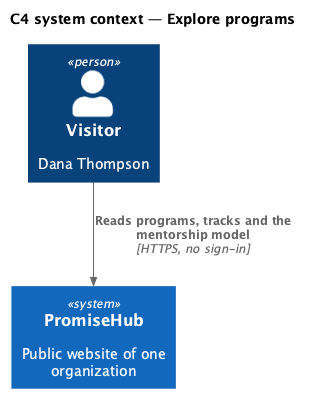
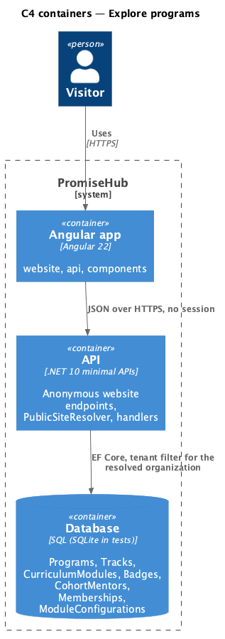
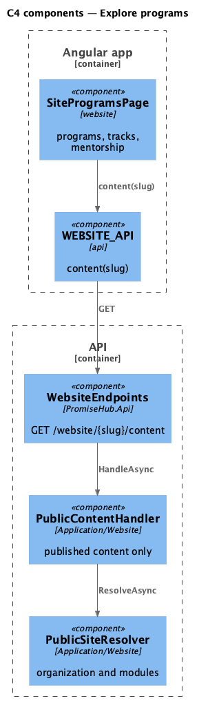
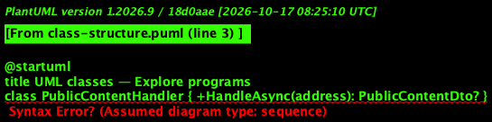
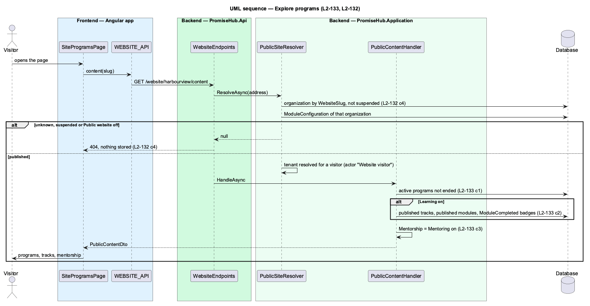

# Explore programs

## Overview

The Programs page (`site-programs`) tells a family what an organization offers. Every organization lists its current programs; while Learning is on, it also shows what youth learn (each published track, its published modules and the badge each module earns), and while Mentoring is on, how mentoring works. Nothing that is a draft, and nothing from a module that is off, is ever answered.

Terms used in this document:

- **published** — a track or module whose `ContentStatus` is `Published`; a track shows only with at least one published module
- **outcome badge** — a badge whose rule is `ModuleCompleted` for that module and that is not deleted
- **mentorship model** — the fixed description of weekly check-ins, feedback and extra support, shown while Mentoring is on

Ported from Waypoint's `public-site/explore-programs` design (`L2-PUB-002` criterion 1), with tenancy and the Public website module gate added (ADR 0043, ADR 0075).

## Description

Frontend:

- **`SiteProgramsPage`** (`frontend/projects/website/`) — the hero, the programs section (see browse-current-cohorts), the Learning tracks section (`ph-card` per track, an ordered list of modules with a success `ph-badge` for the badge) only when tracks are answered, and the mentorship section (`ph-list`) only when `mentorship` is true; loading `ph-skeleton`, error `ph-empty-state` with Try again.
- **`WEBSITE_API.content(slug)`** — `PublicContent`.

Backend:

- **`PublicContentHandler.HandleAsync(address)`** (`PromiseHub.Application/Website/`) — after the resolver: programs; while Learning is on, published tracks with published modules in position order and each module's outcome badge; `Mentorship` true while Mentoring is on; the impact counts.
- **`PublicContentDto`**, **`PublicTrackDto`**, **`PublicModuleDto`** — the answer; no lesson, quiz or person is in it.
- **`GET /website/{slug}/content`** — anonymous.

## Built so far

Prompt 81 delivered everything above. Acceptance tests: `backend/tests/PromiseHub.Api.Tests/PublicContentTests.cs`, `e2e/tests/website/programs.spec.ts`.

## Requirements

| L2 ID | Refines (L1) | Requirement |
|-------|--------------|-------------|
| `L2-133` | `L1-025` | The public pages show only what an organization has published: current programs with a link to apply, published tracks and modules while Learning is on, and the mentorship model and lead mentors while Mentoring is on. |
| `L2-132` | `L1-025` | While Public website is on, a visitor reads an organization's public pages at `/site/{address}` without an account; an unknown address, a suspended organization and the module off all answer the same not-found page and 404. |
| `L2-005` | `L1-002` | Every endpoint of a module that is off answers 404 for that organization, and the frontend never renders, links or prefetches it. |
| `L2-001` | `L1-001` | Every query filters by the organization; another organization's data is never returned. |

## Diagrams

A visitor reads what the organization offers without signing in.

The Angular app calls the API anonymously; the API resolves the organization from the address and reads its module configuration on every request.

One content endpoint answers every section; sections of an off module are simply absent.

Tracks hold their modules; each module may name the badge completing it earns.

Learning and Mentoring are read from the resolved organization's configuration, never from a session.

