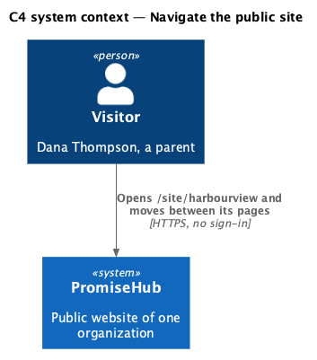
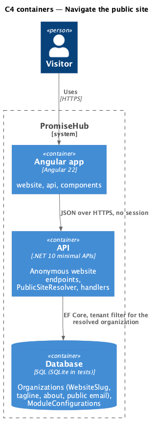
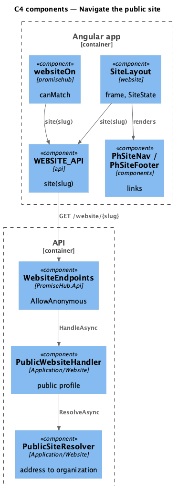
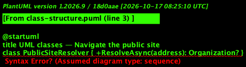
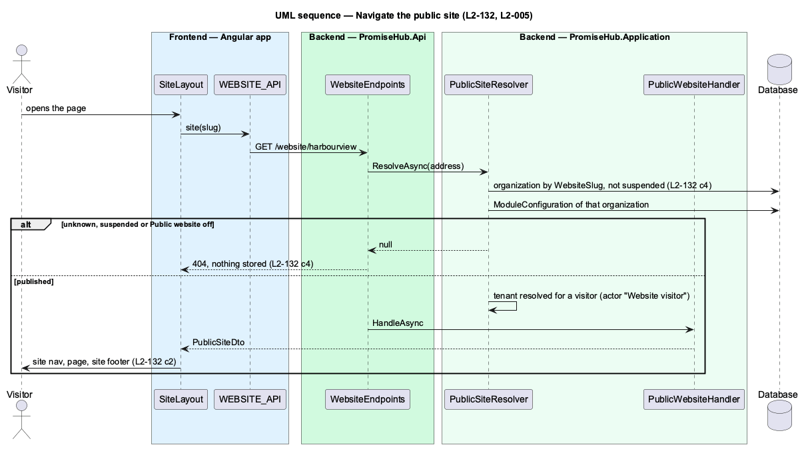

# Navigate the public site

## Overview

Every public page of an organization shares one frame: the site nav at the top and the site footer at the bottom, around one wide column. The frame loads once, from the organization's public profile, and every page inside it is reached without signing in. The address `/site/{address}` names the organization; this is the one place PromiseHub chooses a tenant without a membership (ADR 0043, ADR 0075). An unknown address, a suspended organization and Public website off all look the same: the not-found page.

Terms used in this document:

- **address** — the organization's public website slug (`Organization.WebsiteSlug`), edited in the website profile (L2-126)
- **site nav** — `ph-site-nav`: the organization's name linking home, Programs, About, Get involved, Contact, Sign in and Apply
- **site footer** — `ph-site-footer`: the same pages plus Privacy and the city

Ported from Waypoint's `public-site/navigate-public-site` design (`L2-PUB-001` criteria 1, 3 and 4), with tenancy and the Public website module gate added (ADR 0043, ADR 0075).

## Description

Frontend:

- **`websiteOn`** (`frontend/projects/promisehub/src/app/modules/website.guard.ts`) — `canMatch` on `/site/:slug`: asks `WEBSITE_API.site(slug)` and matches only when the site loads, so the `website` library is never downloaded for a site that is not published; otherwise the app's `SiteNotFoundPage` shows.
- **`SiteLayout`** (`frontend/projects/website/`) — the route component of `/site/:slug`: reads `WEBSITE_API.site` and `WEBSITE_API.content` once, keeps them in `SiteState`, sets the page title and renders `ph-skip-link`, `ph-site-nav`, the outlet and `ph-site-footer`.
- **`SiteState`** — the feature's provider at the layout: the slug, the site profile and the content result, read by every page.
- **`PhSiteNav`**, **`PhSiteFooter`** (`frontend/projects/components/`) — the design-system components; links are given as `{ label, path }` and rendered with `routerLink`, the current page marked with `aria-current`.
- Child routes: `''` home, `programs`, `about`, `get-involved`, `contact`, `privacy`; any other path redirects home.

Backend:

- **`PublicSiteResolver`** (`PromiseHub.Application/Website/`) — finds the organization by address ignoring the tenant filter for that one lookup, refuses a suspended organization, resolves the tenant for a visitor (`TenantContext.ResolveForVisitor`, actor "Website visitor") and answers null unless that organization's Public website module is on.
- **`PublicWebsiteHandler`** — `GET /website/{slug}`: `PublicSiteDto(name, city, tagline, about, email)`.
- **`WebsiteEndpoints`** (`PromiseHub.Api/Endpoints/`) — every website endpoint, each `AllowAnonymous()`; a null answer is 404 with no body.

## Built so far

Prompt 81 delivered everything above. Acceptance tests: `backend/tests/PromiseHub.Api.Tests/PublicSiteTests.cs`, `e2e/tests/website/navigate.spec.ts`.

## Requirements

| L2 ID | Refines (L1) | Requirement |
|-------|--------------|-------------|
| `L2-132` | `L1-025` | While Public website is on, a visitor reads an organization's public pages at `/site/{address}` without an account; an unknown address, a suspended organization and the module off all answer the same not-found page and 404. |
| `L2-005` | `L1-002` | Every endpoint of a module that is off answers 404 for that organization, and the frontend never renders, links or prefetches it. |
| `L2-001` | `L1-001` | Every query filters by the organization; another organization's data is never returned. |
| `L2-033` | `L1-018` | Pages and reads stay within the performance budgets. |

## Diagrams

A visitor opens an organization's public address in a browser; nothing asks them to sign in.

The Angular app calls the API anonymously; the API resolves the organization from the address and reads its module configuration on every request.

The guard and the layout read the same anonymous endpoint; the resolver chooses the organization from the address.

The resolver is shared by every website handler, so every endpoint answers 404 in the same cases.

Unknown, suspended and off answer 404 before any handler reads data, and the library never loads for them.

