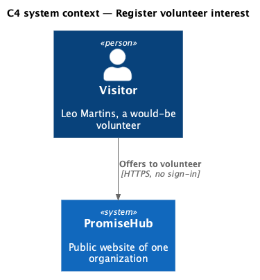
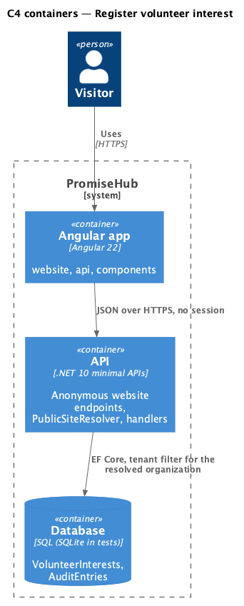
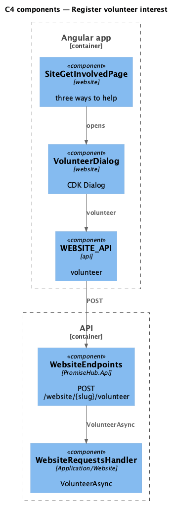
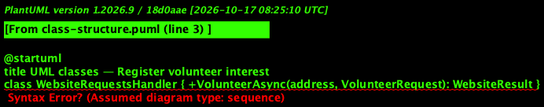
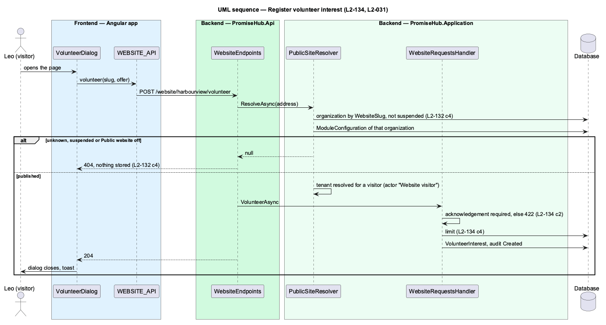

# Register volunteer interest

## Overview

Get involved (`site-get-involved`) offers three ways to help. Sign up to volunteer opens a dialog (`volunteer-interest`) for a name, an email, an optional phone, how the person would like to help, an optional note and the acknowledgement that volunteers who work with children are screened and reference checked. Without the acknowledgement nothing is sent. The offer is stored for the organization and audited; turning an offer into a Volunteer account is staff work outside this journey.

Terms used in this document:

- **area** — Homework help, Coaching a sports team, Camp helper, Driving and setup or Wherever I’m needed
- **screening acknowledgement** — the required checkbox, stored with the offer

Ported from Waypoint's `public-site/register-volunteer-interest` design (`L2-PUB-003` criterion 2), with tenancy and the Public website module gate added (ADR 0043, ADR 0075).

## Description

Frontend:

- **`SiteGetInvolvedPage`** — three `ph-card`s; Sign up to volunteer opens `VolunteerDialog` through `PhDialogs`; on success a toast.
- **`VolunteerDialog`** — `ph-text-field`, `ph-select`, `ph-textarea`, `ph-checkbox`, `ph-error-summary`, `ph-alert` (failed, too-many).
- **`WEBSITE_API.volunteer(slug, request)`**.

Backend:

- **`WebsiteRequestsHandler.VolunteerAsync`** — the same resolver, validation, limit and audit as contact; stores a `VolunteerInterest` with `ScreeningAcknowledged`.
- **`POST /website/{slug}/volunteer`** — anonymous.

## Built so far

Prompt 81 delivered everything above. Acceptance tests: `backend/tests/PromiseHub.Api.Tests/WebsiteRequestsTests.cs`, `e2e/tests/website/get-involved.spec.ts`.

## Requirements

| L2 ID | Refines (L1) | Requirement |
|-------|--------------|-------------|
| `L2-134` | `L1-025` | Contact messages, volunteer offers and monthly donation pledges are validated on the server, stored for that organization only, audited, acknowledged and limited per email. |
| `L2-031` | `L1-016` | Transport, storage and application security: input is validated on the server and output is encoded. |
| `L2-032` | `L1-017` | Every sensitive action is written to the organization's audit log. |
| `L2-001` | `L1-001` | Every query filters by the organization; another organization's data is never returned. |

## Diagrams

A would-be volunteer offers to help without an account.

The Angular app calls the API anonymously; the API resolves the organization from the address and reads its module configuration on every request.

The page opens the dialog through `PhDialogs`; the dialog posts the offer.

The offer keeps the acknowledgement so staff can see it was given.

Without the acknowledgement the server refuses and stores nothing.

