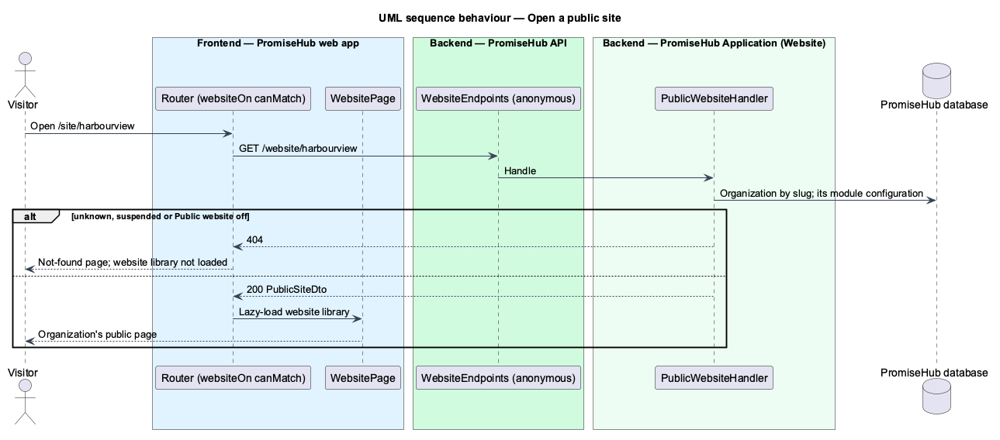

# Serve public site

## Overview

The first slice of the **Public website** module (`L1-025`). A visitor opens `/site/{slug}` without signing in. The slug names the organization, the one place a tenant is chosen without a membership. Only an organization that runs, has the module on and owns the slug answers; every other case looks the same as a page that does not exist.

## Description

- **`Organization.WebsiteSlug`** — unique, lower-case public name (`harbourview`, `northgate`).
- **`PublicWebsiteHandler`** (`PromiseHub.Application/Website/`) finds the organization by slug, ignoring the tenant filter for that single lookup, reads that organization's `ModuleConfiguration`, and returns `PublicSiteDto(name, city)` or NotFound for an unknown slug, a suspended organization or Public website off.
- **`GET /website/{slug}`** (`WebsiteEndpoints`) is anonymous.
- **`WEBSITE_API`** with `HttpWebsiteApi.site(slug)`; the shell's `websiteOn` `canMatch` calls it so the `website` library loads only for a published site.
- **`WebsitePage`** (`frontend/projects/website/`) composes `ph-guardian-shell`, `ph-page-header`, `ph-card` and `ph-empty-state` (`website`).

## Requirements

| L2 ID | Refines (L1) | Requirement |
|-------|--------------|-------------|
| `L2-005` | `L1-002` | A module that is off is neither served nor rendered. |

## Diagrams

### Behaviour — open a public site

Unknown, suspended and off all answer 404 and the not-found page shows; a published site loads the library (`L2-005` criterion 7).

