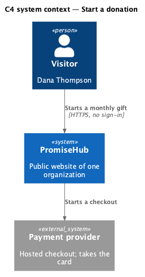
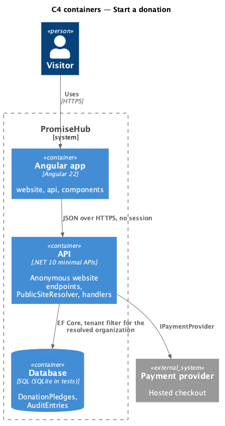
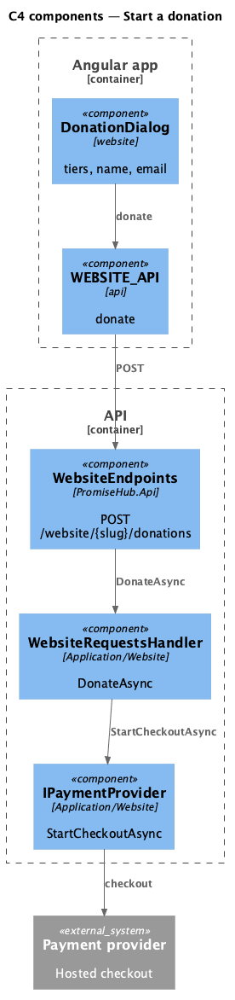
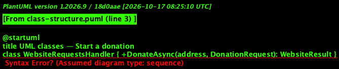
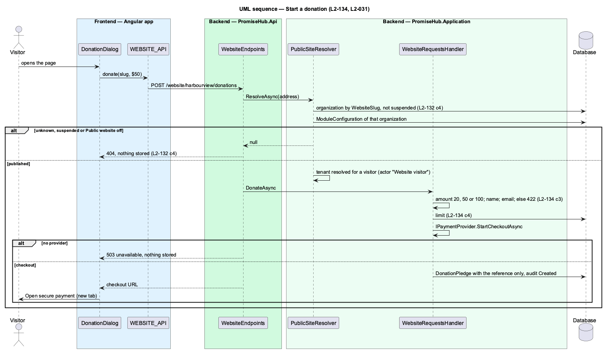

# Start a donation

## Overview

Give monthly (`start-donation`) lets a visitor choose $20, $50 or $100 a month and give a name and an email for the receipt. PromiseHub asks the payment provider for a hosted checkout, stores the pledge with the provider's reference and hands the visitor to the provider in a new tab. Card details never reach PromiseHub. The provider sits behind `IPaymentProvider`; tests use a fake, and a real provider is deferred until an organization has credentials (ADR 0075). Without one the dialog says online giving isn’t available yet and nothing is stored.

Terms used in this document:

- **pledge** — `DonationPledge`: amount, name, email, the provider's reference and when
- **checkout** — `PaymentCheckout(Reference, Url)` answered by the provider

Ported from Waypoint's `public-site/start-donation` design (`L2-PUB-003` criterion 3), with tenancy and the Public website module gate added (ADR 0043, ADR 0075).

## Description

Frontend:

- **`DonationDialog`** — `ph-radio-group` (the three tiers with hints), `ph-text-field` (name, email), `ph-error-summary`, `ph-alert` (confirmed, failed, unavailable); confirmed offers Open secure payment, a link with `target="_blank"` and `rel="noopener"`.
- **`WEBSITE_API.donate(slug, request)`** — `DonationCheckout` or the outcome.

Backend:

- **`WebsiteRequestsHandler.DonateAsync`** — resolver, validation (amount 20, 50 or 100), limit, then `IPaymentProvider.StartCheckoutAsync`; null means not set up (503 `unavailable`, nothing stored); otherwise stores the `DonationPledge`, audits Created and answers `DonationCheckoutDto(CheckoutUrl)`.
- **`IPaymentProvider`** (`PromiseHub.Application/Website/`) and **`UnconfiguredPaymentProvider`** (`PromiseHub.Infrastructure/Payments/`), which answers null; tests register `FakePaymentProvider`.
- **`POST /website/{slug}/donations`** — anonymous.

## Built so far

Prompt 81 delivered everything above except a real payment provider (deferred, ADR 0075). Acceptance tests: `backend/tests/PromiseHub.Api.Tests/WebsiteRequestsTests.cs`, `e2e/tests/website/get-involved.spec.ts`.

## Requirements

| L2 ID | Refines (L1) | Requirement |
|-------|--------------|-------------|
| `L2-134` | `L1-025` | Contact messages, volunteer offers and monthly donation pledges are validated on the server, stored for that organization only, audited, acknowledged and limited per email. |
| `L2-031` | `L1-016` | Transport, storage and application security: input is validated on the server and output is encoded. |
| `L2-032` | `L1-017` | Every sensitive action is written to the organization's audit log. |
| `L2-001` | `L1-001` | Every query filters by the organization; another organization's data is never returned. |

## Diagrams

The visitor pays the provider directly; PromiseHub only records the pledge.

The Angular app calls the API anonymously; the API resolves the organization from the address and reads its module configuration on every request.

The handler depends on the provider abstraction, never on a vendor SDK.

The pledge stores the provider's reference and never a card detail.

Nothing is stored unless the provider answered a checkout.

