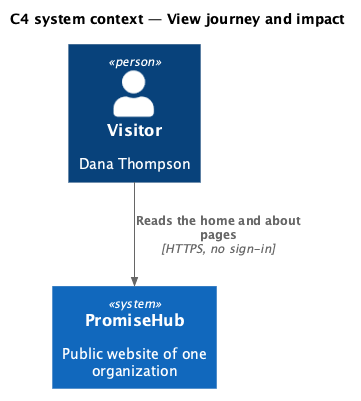
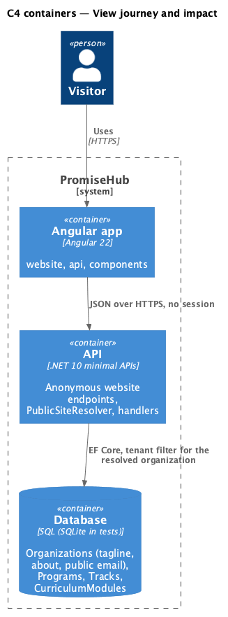
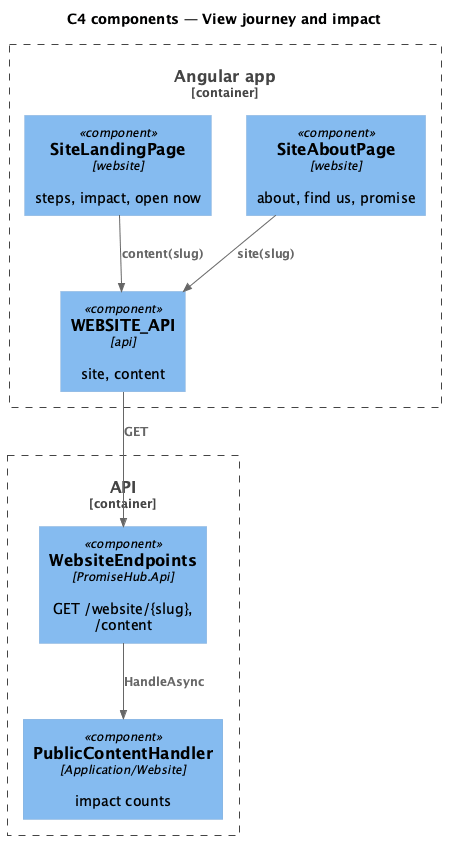
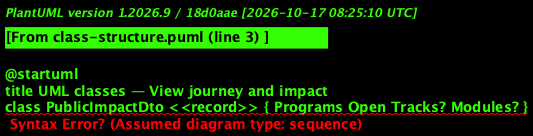
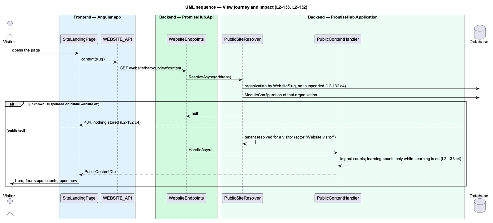

# View journey and impact

## Overview

The home page (`site-landing`) introduces the organization: its name, city and tagline, how joining works in four steps, what it runs in numbers and the programs open now. The about page (`site-about`) adds the organization's own words, where to find it and its promise to families. The numbers are of programs and published content only; PromiseHub never publishes counts of children or staff.

Terms used in this document:

- **journey** — the four fixed steps: Find a program, Apply online, We say hello, Grow with us
- **impact** — programs running, programs open for enrollment and, while Learning is on, published tracks and modules

Ported from Waypoint's `public-site/view-journey-and-impact` design (`L2-PUB-002` criterion 3), with tenancy and the Public website module gate added (ADR 0043, ADR 0075).

## Description

Frontend:

- **`SiteLandingPage`** — hero (`ph-button` See programs, Get involved), four `ph-card` steps, `ph-stat` counts, up to three open programs and See every program; empty and error states.
- **`SiteAboutPage`** — the about text or "Our story is coming soon", Find us (`ph-description-list` with the city and public email), Our promise (`ph-list`).

Backend:

- **`PublicContentHandler`** — `PublicImpactDto(Programs, Open, Tracks?, Modules?)`, the learning counts null while Learning is off.
- **`PublicWebsiteHandler`** — the tagline, about text and public email from the website profile (L2-126).

## Built so far

Prompt 81 delivered everything above. Acceptance tests: `backend/tests/PromiseHub.Api.Tests/PublicContentTests.cs`, `e2e/tests/website/landing.spec.ts`, `e2e/tests/website/about.spec.ts`.

## Requirements

| L2 ID | Refines (L1) | Requirement |
|-------|--------------|-------------|
| `L2-133` | `L1-025` | The public pages show only what an organization has published: current programs with a link to apply, published tracks and modules while Learning is on, and the mentorship model and lead mentors while Mentoring is on. |
| `L2-132` | `L1-025` | While Public website is on, a visitor reads an organization's public pages at `/site/{address}` without an account; an unknown address, a suspended organization and the module off all answer the same not-found page and 404. |

## Diagrams

A visitor reads who the organization is and how joining works.

The Angular app calls the API anonymously; the API resolves the organization from the address and reads its module configuration on every request.

The layout already holds the profile and the content; the home and about pages read them from `SiteState`.

Impact counts are structural; the learning counts are absent while Learning is off.

The counts come from the same answer as the programs, so the home page and the programs page always agree.

